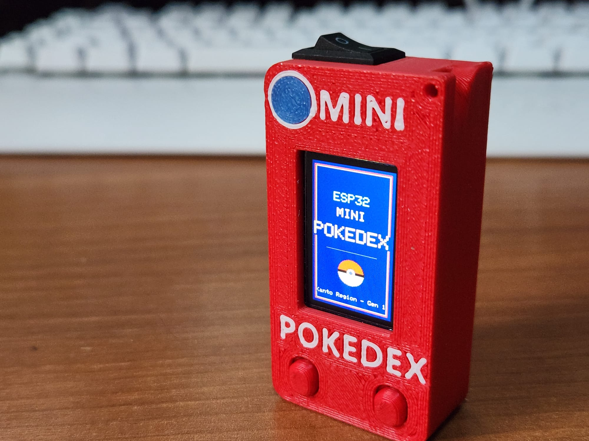
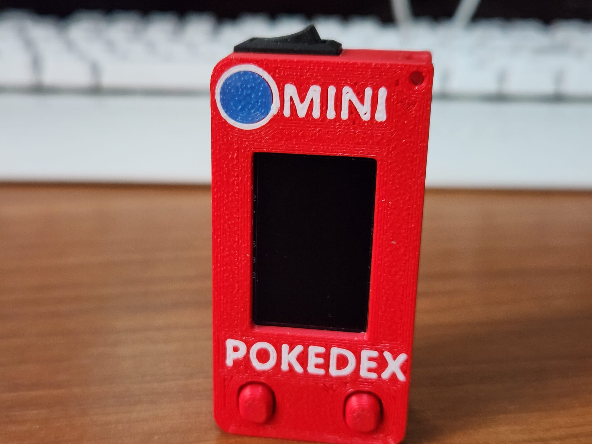
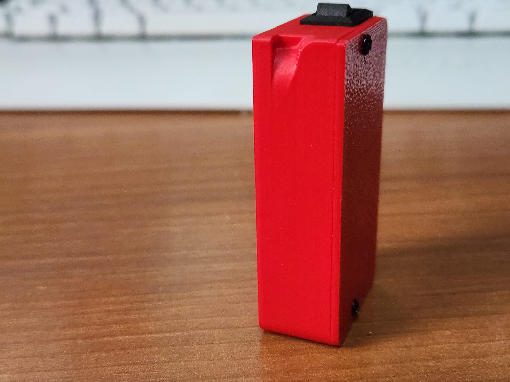
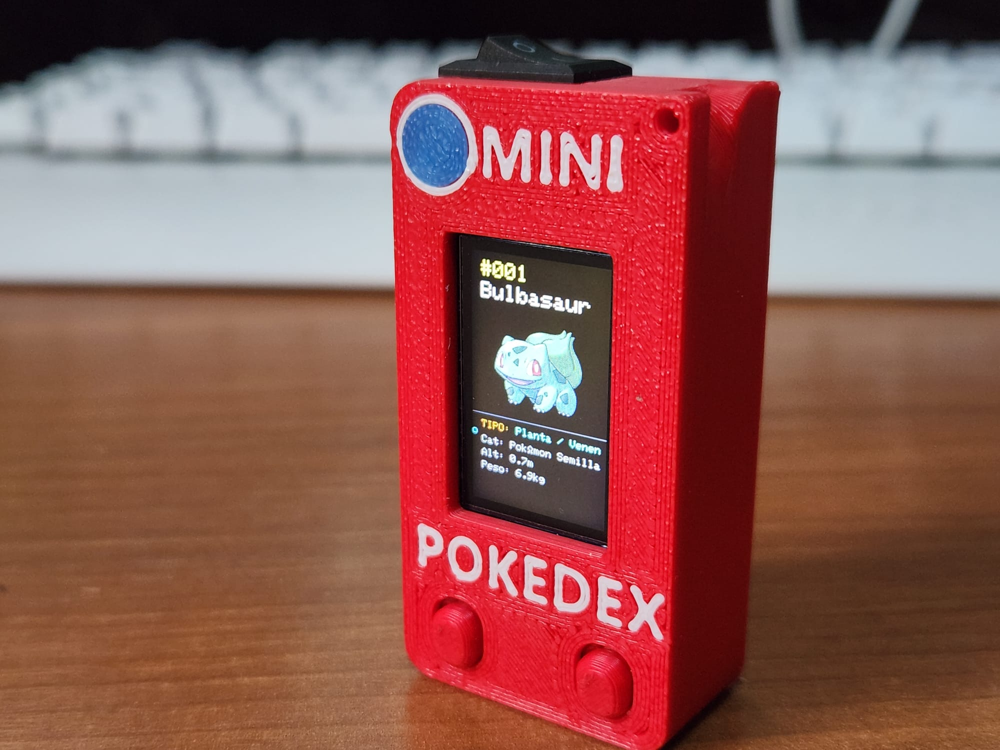
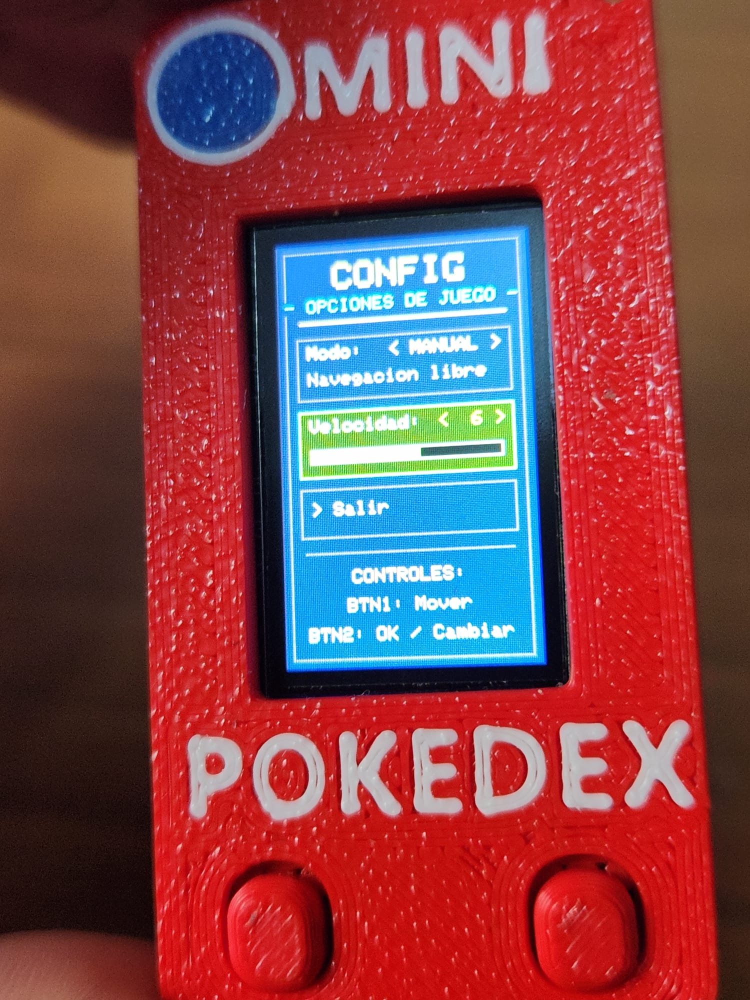

# MINI Pokédex ESP3 🎮


Este proyecto es una Pokédex interactiva desarrollada para la placa de desarrollo **TENSTAR TS-ESP32-S3**
<p align="center">
  
</p>

<p align="center">
  
  
</p>

<p align="center">
  
  
</p>

Este es un proyecto de fans para fans, que utiliza la **PokéAPI** y es sin fines de lucro.

Este proyecto es una Pokédex interactiva desarrollada para la placa de desarrollo ESP32 **TENSTAR DE 16 MB** 
acá el enlace:
[TENSTAR 16 mb  AliExpress](https://www.aliexpress.us/item/3256809703899160.html?spm=a2g0o.order_list.order_list_main.5.b3421802lGkqaE&gatewayAdapt=glo2usa)


El repositorio incluye el código fuente en C++, los datos de los Pokémon y herramientas automatizadas en Python para facilitar la instalación y el flasheo del firmware.

---

## 📂 Estructura del Repositorio

* `poke151.ino`: Código fuente principal de la Pokédex para Arduino.
* `pokemon_data.h`: Archivo de cabecera con la información y datos estructurados de los Pokémon.
* `flasheador_pokedex.py`: Aplicación/script en Python para automatizar el flasheo del firmware en la placa.
* `Prerequistos.bat`: Script ejecutable para instalar automáticamente las librerías necesarias de Python.
* `arduino-cli.exe`: Herramienta de línea de comandos de Arduino integrada para compilar y flashear sin depender del IDE gráfico.
* `libraries/`: Carpeta con las librerías requeridas para la compilación del proyecto.
* `LICENSE.txt`: Términos de la licencia del proyecto.

## ⚙️ Configuración e Instalación

### Opción 1: Subir desde Arduino IDE
Si prefieres compilar y subir el proyecto de forma manual:

1. Abre el archivo `poke151.ino` en **Arduino IDE**.
2. En el menú **Herramientas (Tools)**, aplica la siguiente configuración:
   * **Placa (Board):** `ESP32S3 Dev Module`
   * **Tamaño de Flash (Flash Size):** `16MB`
   * **Esquema de Partición (Partition Scheme):** `Huge APP (3MB No OTA / 1MB SPIFFS)`
3. Copia el contenido de la carpeta `libraries/` a tu directorio local de librerías de Arduino (o asegúrate de que el IDE las reconozca).
4. Selecciona el puerto COM correspondiente y haz clic en **Subir (Upload)**.

---

### Opción 2: Flasheo Automático con Python
Si vas a utilizar la herramienta interactiva en Python:

1. Conecta la placa ESP32-S3 a la PC mediante el cable USB-C.
2. Ejecuta el archivo script para instalar automáticamente las dependencias necesarias:
   ```cmd
   Prerequistos.bat

---

ARCHIVOS DE IMPRESIÓN 3D
   [📥 Descargar diseño 3D (Mini Pokedex.3mf)](Mini%20pokedex.3mf)

## 🕹️ Modos de Funcionamiento y Menú
<p align="center">
  
</p>
💡 **Nota importante:** Para acceder al menú principal y cambiar de modo en cualquier momento, debes **apretar ambos botones juntos**.

* **📖 Modo Manual:** Recorre la Pokédex ordenadamente paso a paso para consultar cada registro individual.
* **🎲 Modo Random:** Selecciona y muestra un Pokémon completamente al azar.
* **📊 Modo Sensor:** Muestra datos ambientales y de movimiento (temperatura, presión e inclinación) aprovechando los sensores integrados.

---
   
